<div align="center">

# CivicFlow AI

**An AI-assisted permitting workspace for Pakistan.**<br>
Enter plot and project details, see which authority and by-laws apply, get a compliance report
where every flag cites its clause, and estimate fees and timeline before filing.

[](https://civicflow-ai-alpha.vercel.app/)
[](#structure-and-architecture)
[](#how-it-works)
[](#prototype-notice)

[**Live demo**](https://civicflow-ai-alpha.vercel.app/) · [Screens](#screens) · [How a filing moves](#how-a-filing-moves) · [Structure](#structure-and-architecture) · [Team](#team)

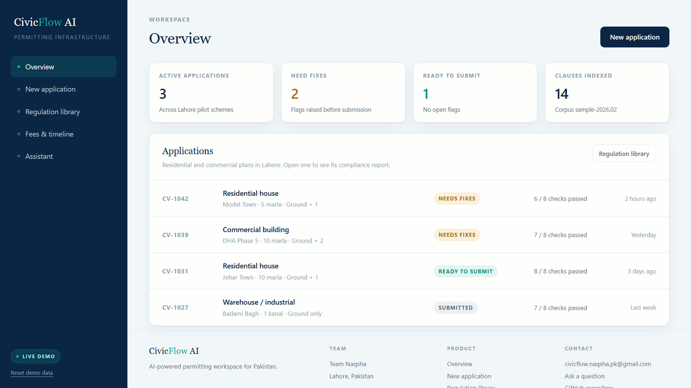

</div>

## What is CivicFlow AI?

Building-plan approval in Pakistan is not one form at one counter. It is a set of by-law documents —
development-authority regulations, society rules, building schedules — plus a checklist that changes
with the plot size, the land use and the number of floors, a fixed document set, and then a
scrutiny queue. The rules exist and they are knowable. What is missing is a workspace that puts the
right clause in front of the applicant **before** they file.

**The problem.** Applicants — homeowners, architects, small developers — work this out by asking
around, reading scanned documents or paying an agent. Applications reach the counter incomplete and
come back as objections, and each objection costs a resubmission fee and another turn in the queue.
The same questions repeat for every applicant, in every society, every term.

**What CivicFlow AI does.** It is the layer before the counter. An applicant describes the plot and
the project in four fields; the workspace resolves the authority and the exact clause set for that
case, checks the document set against the application, and produces a compliance report in which
every check is either a pass or a flag — and every flag names the clause, its version and its
requirement, so the applicant knows exactly what to fix. A fee and timeline estimate answers the
other question every applicant asks: what will this cost, and how long will it take.

**What it never does.** It does not approve, submit or give a legal opinion. There is no authority
login, no queue position and no decision. It is a preparation tool: the report shows what a complete
filing looks like before it reaches the counter.

**Who it is for.** Applicants filing a residential or small-commercial plan in Lahore's
LDA-notified schemes — and the architects and agents who file on their behalf. The first market is
one authority; the product is a rule corpus plus a check engine, so a second authority is rows in
the library, not a new product.

### At a glance

| | |
| --- | --- |
| **Input** | Four fields: project type, plot size, floors, society |
| **Rules** | 14 sample clauses, each with reference, requirement, version and Urdu gloss |
| **Checks** | 8 per application — setbacks, floor area ratio, height, parking, document set |
| **Output** | A cited compliance report, a printable copy, and a fee & timeline estimate |
| **Languages** | English and Urdu, including the assistant |
| **Stack** | Static HTML, CSS and JavaScript — runs in the browser, no backend |

## Prototype notice

> Every application, by-law clause, fee figure and document field in this build is **sample
> content** written for the demo. Nothing is submitted to an authority, and nothing here is an
> authority decision or legal advice.

## Try the live demo

**→ https://civicflow-ai-alpha.vercel.app/**

Three things worth doing first:

1. Open **New application** and run the four-step wizard with LDA-selected sample values — you
   end on a clean, submission-ready report.
2. Open application **CV-1042** from the overview — a rear setback and a floor-area-ratio flag,
   each one clickable through to its clause.
3. Open the **Assistant** and switch the toggle to **اردو** — ask about a setback and the answer
   comes back in Urdu with its clause citation.

## Screens

<table>
  <tr>
    <td width="50%">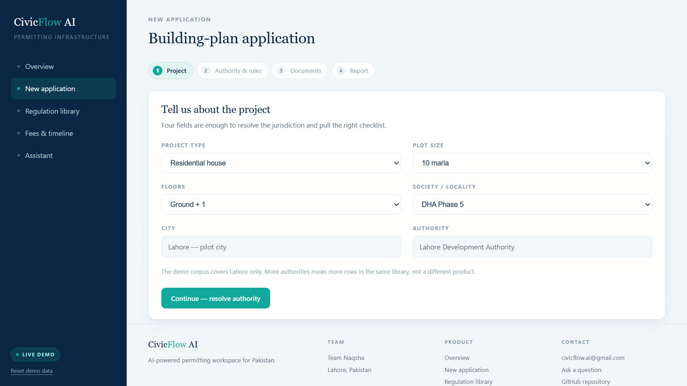</td>
    <td width="50%">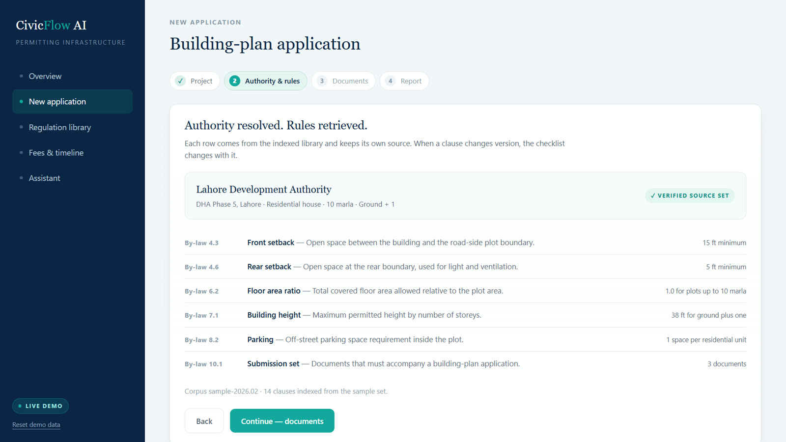</td>
  </tr>
  <tr>
    <td><b>1 · Project</b><br>Four inputs — project type, plot size, floors and society — are enough to resolve the authority.</td>
    <td><b>2 · Authority &amp; rules</b><br>The clause set for that plot, land use and floor count, with reference and requirement.</td>
  </tr>
  <tr>
    <td>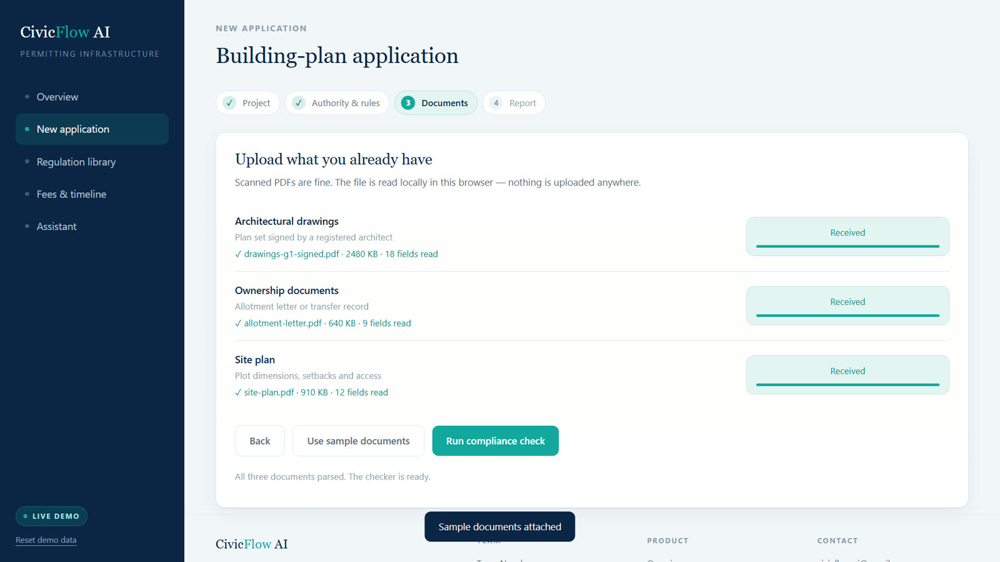</td>
    <td>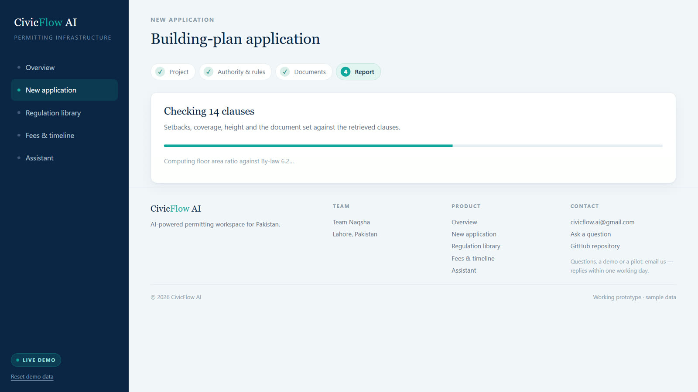</td>
  </tr>
  <tr>
    <td><b>3 · Documents</b><br>The three documents a filing needs, with the fields read from each.</td>
    <td><b>4 · Compliance check</b><br>Setbacks, floor area ratio, height, parking and the document set, measured against the clauses.</td>
  </tr>
  <tr>
    <td></td>
    <td>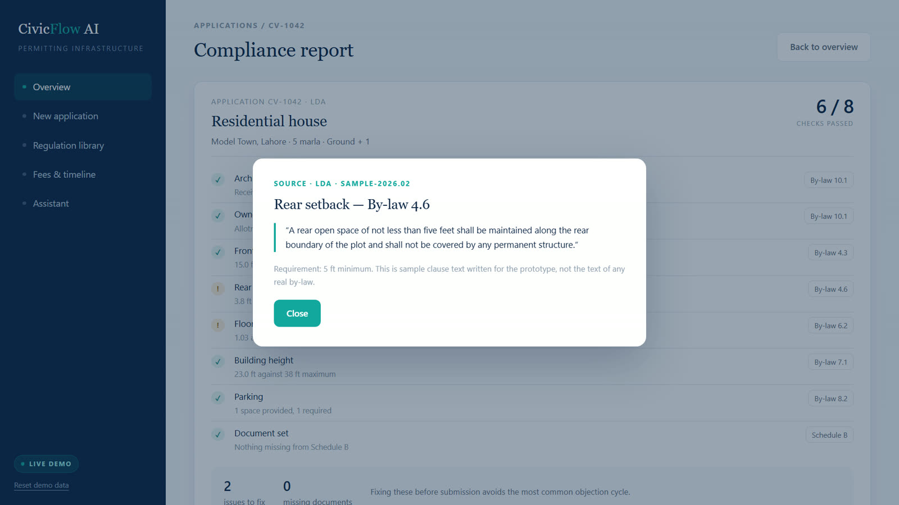</td>
  </tr>
  <tr>
    <td><b>Report with flags</b><br>CV-1042: a rear setback and a floor-area-ratio flag, each one clickable through to its clause.</td>
    <td><b>Cited clause</b><br>The clause reference, its version and the requirement in plain language.</td>
  </tr>
  <tr>
    <td>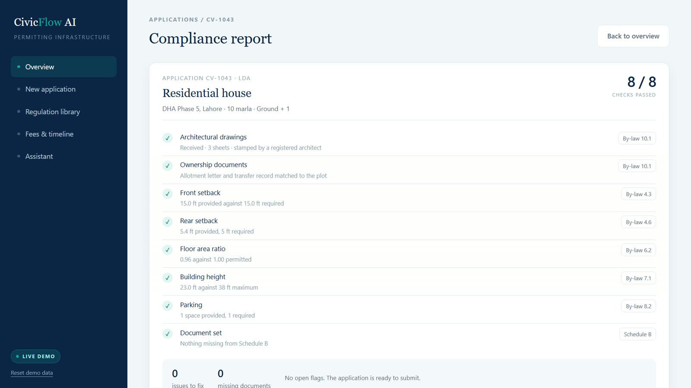</td>
    <td>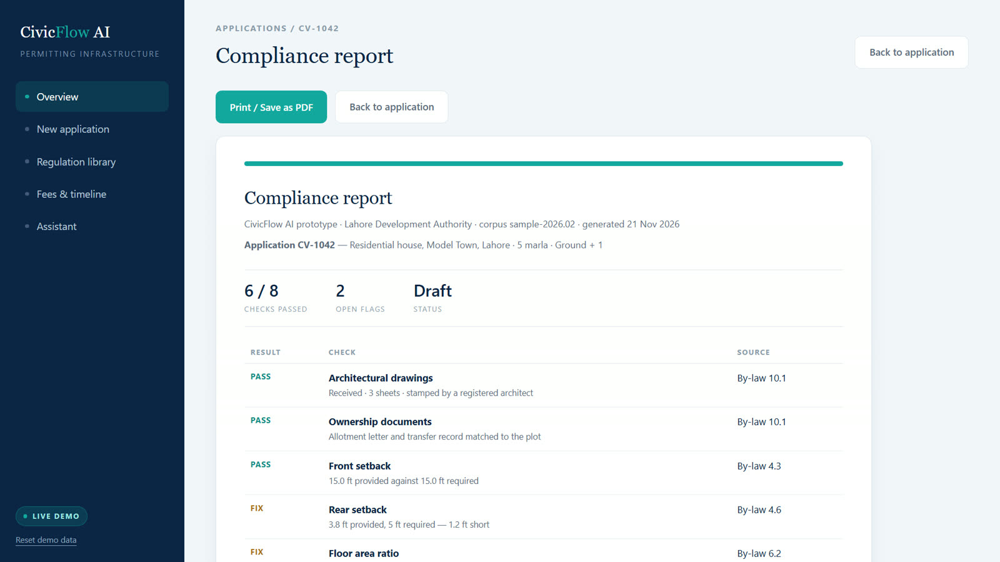</td>
  </tr>
  <tr>
    <td><b>Clean report</b><br>Eight checks passed, no open flags — submission is unlocked.</td>
    <td><b>Printable report</b><br>The same result as a clean sheet for the applicant's file.</td>
  </tr>
  <tr>
    <td></td>
    <td></td>
  </tr>
  <tr>
    <td><b>Regulation library</b><br>The verified data layer — searchable clauses in English and Urdu, each with a version label.</td>
    <td><b>Fees &amp; timeline</b><br>Change the plot, use or floors and the estimate and scrutiny timeline update on a clearly labelled sample fee table.</td>
  </tr>
  <tr>
    <td>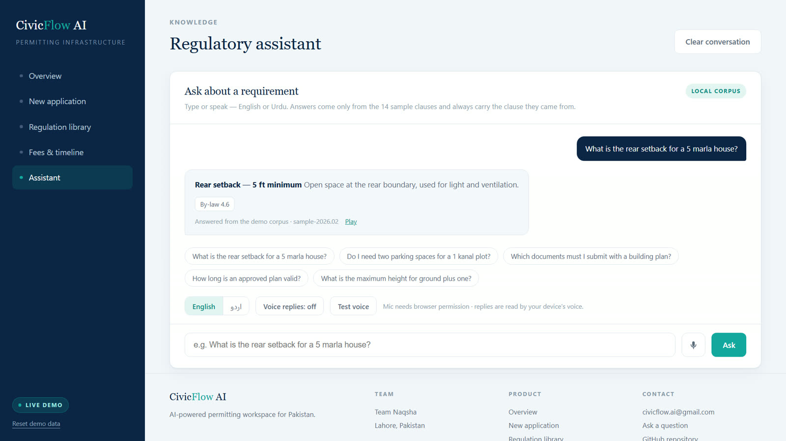</td>
    <td>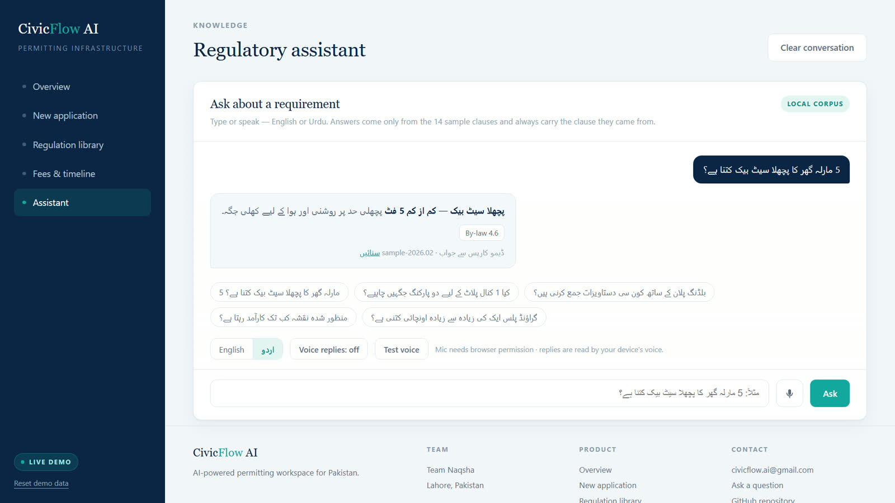</td>
  </tr>
  <tr>
    <td><b>Assistant — English</b><br>Answers only from the indexed corpus and cites the clause it used.</td>
    <td><b>Assistant — اردو</b><br>The same answer in Urdu, with the clause citation and a spoken option where the browser has voices.</td>
  </tr>
</table>

<div align="center">
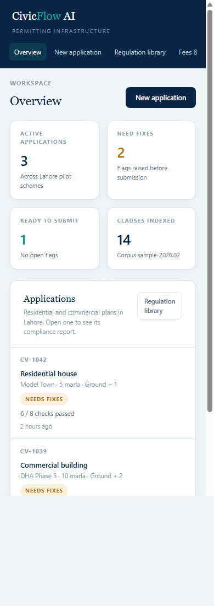<br>
<b>Mobile layout</b> — the same workspace at 390 px
</div>

### One report, top to bottom

<div align="center">
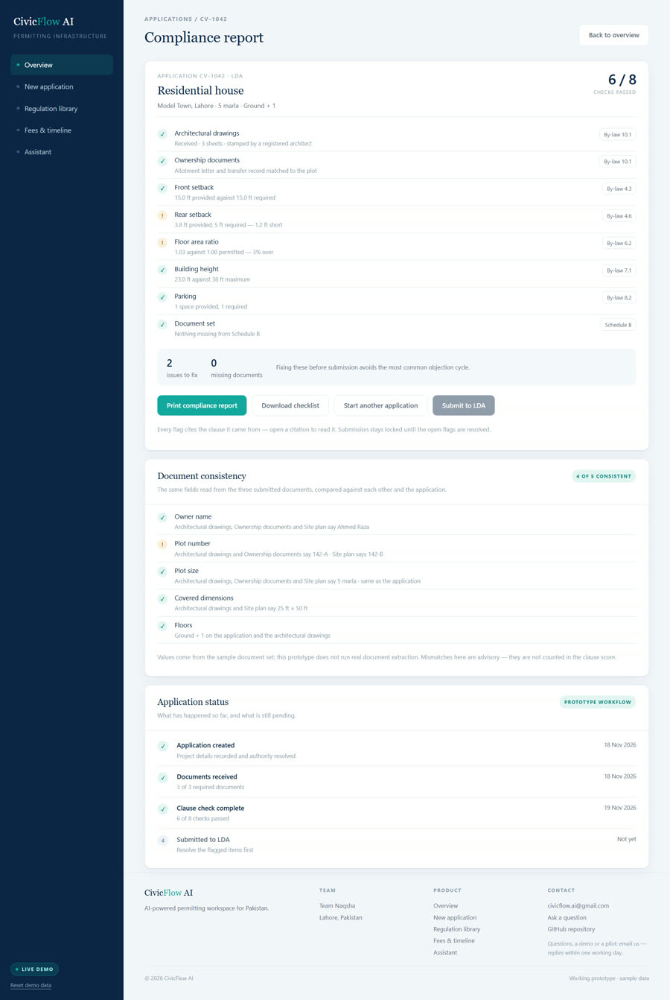
</div>

CV-1042, a five-marla house, on a single page: the application details, the eight checks with their
clause chips, the document consistency table, the application status timeline, and the sample-data
note at the bottom. Two checks fail — rear setback and floor area ratio — so submission stays
locked while the applicant fixes them.

## How a filing moves

1. **Describe the project** — project type, plot size, floors, society.
2. **Resolve the authority and rules** — the applicable authority and clause set for that case.
3. **Check the documents** — drawings, ownership papers and site plan, with the fields read from each.
4. **Read the compliance report** — pass/fail checks, each one linked to its clause.
5. **Estimate fees and timeline** — a sample fee schedule and a planning timeline.
6. **Print or submit** — a printable report ready to attach to a filing.

<div align="center">
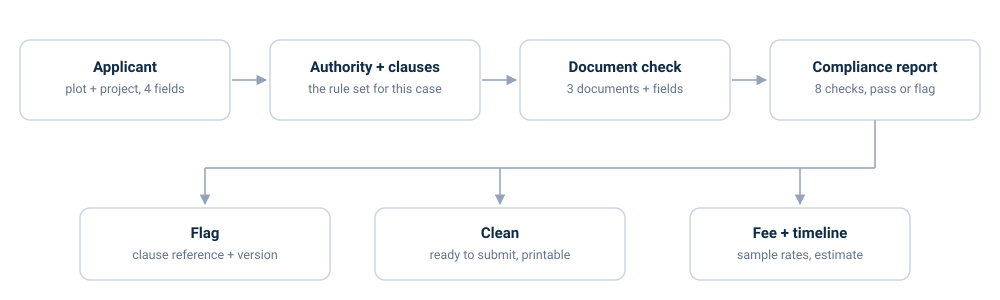
</div>

## Screens and routes

| Route | Screen | What it shows |
| --- | --- | --- |
| `#/dashboard` | Overview | KPI tiles, application list with status chips and check counts |
| `#/new` | New application | Four-step wizard: Project → Authority & rules → Documents → Report |
| `#/app/:id` | Application | Status, summary, check list and filing timeline |
| `#/app/:id/report` | Compliance report | Printable report with cited clauses and pass/fail checks |
| `#/library` | Regulation library | Sample clauses with requirement, version, verification note and Urdu glossary |
| `#/fees` | Fees & timeline | Fee and timeline estimator on the sample fee table |
| `#/assistant` | Assistant | Corpus-only question assistant in English or Urdu |

## Structure and architecture

A static site: HTML, CSS and plain JavaScript. No framework, no build step, no dependencies and no
server. The whole product is four files, plus the diagrams and screenshots in this README.

### Repository structure

```text
.
├── index.html                    page shell: sidebar, screens container, modal, toast
├── styles.css                    design tokens and layout (desktop sidebar, mobile layout)
├── app.js                        hash router, screens, wizard, check engine, report, assistant, storage
├── data.js                       sample content: authority, clauses, document types, fee schedule, seed apps
├── diagrams/                     the two diagrams in this README (SVG)
├── screenshots/                  the screens gallery in this README
└── CivicFlow-AI-Pitch-Best.pptx  the 14-slide pitch deck
```

### How the app is put together

<div align="center">
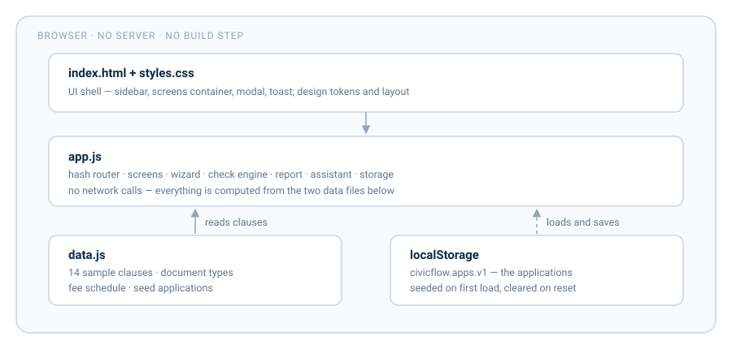
</div>

### The eight checks

| Check | Source |
| --- | --- |
| Architectural drawings | By-law 10.1 |
| Ownership documents | By-law 10.1 |
| Front setback | By-law 4.3 |
| Rear setback | By-law 4.6 |
| Floor area ratio | By-law 6.2 |
| Building height | By-law 7.1 |
| Parking | By-law 8.2 |
| Document set | Schedule B |

## How it works

- **Routing** — hash routes rendered by a small router in `app.js`.
- **State** — applications persist in `localStorage` under `civicflow.apps.v1`; four applications
  are seeded on first load and "Reset demo data" returns to that state.
- **Checks** — the report is computed from the project inputs, the document fields and the clause
  set. No network calls.
- **Assistant** — keyword/corpus matching over the same clause set, with English and Urdu output.
  It is not an LLM backend.
- **Privacy** — no login, no backend, no analytics, no external request. Nothing leaves the browser.

## Run locally

Any static file server works; no tooling required.

```bash
python -m http.server 8000
```

Then open http://localhost:8000 — opening `index.html` directly works in most browsers too.

## Deploy

The repository root is a plain static site, so Vercel needs no configuration: import the repo,
keep **Framework Preset: Other** with empty build, output and install commands, and deploy. Every
push to `main` redeploys. The same files run on any static host.

## Team

**Team Naqsha** — BS Computer Science, Lahore, Pakistan.

Questions, a demo or a pilot: [civicflow.ai@gmail.com](mailto:civicflow.ai@gmail.com)

## Sample data and limits

- By-law text, fee rates and timelines are sample content — not an official notification.
- Document fields are fixed sample values; this build does not run OCR or vision extraction.
- The assistant is corpus-only and is not legal advice.
- Data is device-local; clearing browser storage removes it.

---

<div align="center">

**Working prototype · sample data**<br>
[Live demo](https://civicflow-ai-alpha.vercel.app/) · [Source](https://github.com/sumyiabutt/CivicFlow-AI)

</div>
