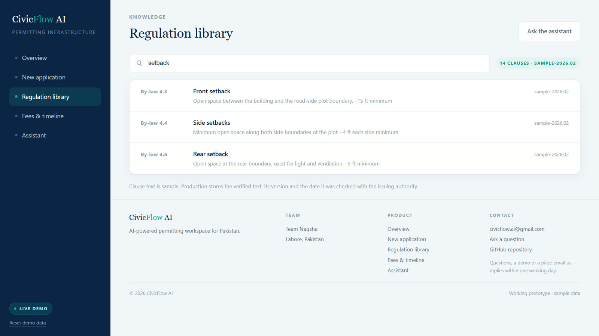
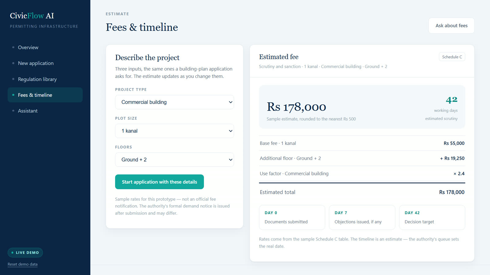

<div align="center">

# CivicFlow AI

**An AI-assisted permitting workspace for Pakistan.**<br>
Enter plot and project details, see which authority and by-laws apply, get a compliance report
where every flag cites its clause, and estimate fees and timeline before filing.

[](https://civicflow-ai-alpha.vercel.app/)
[](#built-with)
[](#how-it-works)
[](#prototype-notice)

[**Live demo**](https://civicflow-ai-alpha.vercel.app/) · [Screens](#screens) · [How it works](#how-a-filing-moves) · [Team](#team)


</div>

## What is CivicFlow AI?

Building-plan approval in Pakistan runs on scattered by-law documents, a paper checklist and a
queue. Most applications reach the counter incomplete, so they come back as objections — and the
applicant pays a resubmission fee to learn something that was knowable on day one.

CivicFlow AI is the layer *before* the counter. An applicant describes the plot, the workspace
resolves the authority and the exact clauses that apply, checks the document set, and produces a
compliance report where every flag names the clause it came from. It guides the applicant — it
never approves the project.

- No login, no install — everything runs in the browser.
- Every flag is traceable to a clause, version and requirement.
- English and Urdu, on screen and in the assistant.

## Prototype notice

> Every application, by-law clause, fee figure and document field in this build is **sample
> content** written for the demo. Nothing is submitted to an authority, and nothing here is an
> authority decision or legal advice.

## Try the live demo

**→ https://civicflow-ai-alpha.vercel.app/**

Three things worth doing first:

1. Open **New application** and run the four-step wizard with LDA-selected sample values — you
   end on a clean, submission-ready report.
2. Open application **CV-1042** from the overview — a rear setback and a floor-area-ratio flag,
   each one clickable through to its clause.
3. Open the **Assistant** and switch the toggle to **اردو** — ask about a setback and the answer
   comes back in Urdu with its clause citation.

## Screens

<table>
  <tr>
    <td width="50%"></td>
    <td width="50%"></td>
  </tr>
  <tr>
    <td><b>Authority &amp; rules</b><br>Four inputs are enough to resolve the authority and pull the clause set for that plot, land use and floor count.</td>
    <td><b>Document check</b><br>The three documents a filing needs, with the fields read from each and a consistency check against the application.</td>
  </tr>
  <tr>
    <td></td>
    <td></td>
  </tr>
  <tr>
    <td><b>Cited flags</b><br>Every flag opens its source: clause reference, version, requirement in plain language.</td>
    <td><b>Regulation library</b><br>The verified data layer — searchable clauses in English and Urdu, each with a version label.</td>
  </tr>
  <tr>
    <td></td>
    <td></td>
  </tr>
  <tr>
    <td><b>Fees &amp; timeline</b><br>Change the plot, use or floors and the estimate and scrutiny timeline update on a clearly labelled sample fee table.</td>
    <td><b>Assistant (اردو)</b><br>Answers only from the indexed corpus, cites the clause it used, and says so when the corpus does not cover a question.</td>
  </tr>
</table>

## How a filing moves

1. **Describe the project** — project type, plot size, floors, society.
2. **Resolve the authority and rules** — the applicable authority and clause set for that case.
3. **Check the documents** — drawings, ownership papers and site plan, with the fields read from each.
4. **Read the compliance report** — pass/fail checks, each one linked to its clause.
5. **Estimate fees and timeline** — a sample fee schedule and a planning timeline.
6. **Print or submit** — a printable report ready to attach to a filing.

## Screens and routes

| Route | Screen | What it shows |
| --- | --- | --- |
| `#/dashboard` | Overview | KPI tiles, application list with status chips and check counts |
| `#/new` | New application | Four-step wizard: Project → Authority & rules → Documents → Report |
| `#/app/:id` | Application | Status, summary, check list and filing timeline |
| `#/app/:id/report` | Compliance report | Printable report with cited clauses and pass/fail checks |
| `#/library` | Regulation library | Sample clauses with requirement, version, verification note and Urdu glossary |
| `#/fees` | Fees & timeline | Fee and timeline estimator on the sample fee table |
| `#/assistant` | Assistant | Corpus-only question assistant in English or Urdu |

## Built with

HTML, CSS and plain JavaScript — no framework, no build step, no dependencies.

```text
.
├── index.html      page shell, navigation, footer, modal and toast containers
├── styles.css      design tokens and layout (desktop sidebar, mobile layout)
├── app.js          hash router, screens, wizard, report logic, assistant, storage
├── data.js         sample content: authority, clauses, doc types, fee schedule, seed apps
└── screenshots/    images used in this README
```

## How it works

- **Routing** — hash routes rendered by a small router in `app.js`.
- **State** — applications persist in `localStorage` under `civicflow.apps.v1`; four applications
  are seeded on first load and "Reset demo data" returns to that state.
- **Checks** — the report is computed from the project inputs, the document fields and the clause
  set. No network calls.
- **Assistant** — keyword/corpus matching over the same clause set, with English and Urdu output.
  It is not an LLM backend.
- **Privacy** — no login, no backend, no analytics, no external request. Nothing leaves the browser.

## Run locally

Any static file server works; no tooling required.

```bash
python -m http.server 8000
```

Then open http://localhost:8000 — opening `index.html` directly works in most browsers too.

## Deploy

The repository root is a plain static site, so Vercel needs no configuration: import the repo,
keep **Framework Preset: Other** with empty build, output and install commands, and deploy. Every
push to `main` redeploys. The same files run on any static host.

## Team

**Team Naqsha** — BS Computer Science, Lahore, Pakistan.

| Member |
| --- |
| Sumyia Butt |
| Wardah Khan |
| Azam Khan |

Questions, a demo or a pilot: [civicflow.ai@gmail.com](mailto:civicflow.ai@gmail.com)

## Sample data and limits

- By-law text, fee rates and timelines are sample content — not an official notification.
- Document fields are fixed sample values; this build does not run OCR or vision extraction.
- The assistant is corpus-only and is not legal advice.
- Data is device-local; clearing browser storage removes it.

---

<div align="center">

**Working prototype · sample data**<br>
[Live demo](https://civicflow-ai-alpha.vercel.app/) · [Source](https://github.com/sumyiabutt/CivicFlow-AI)

</div>
